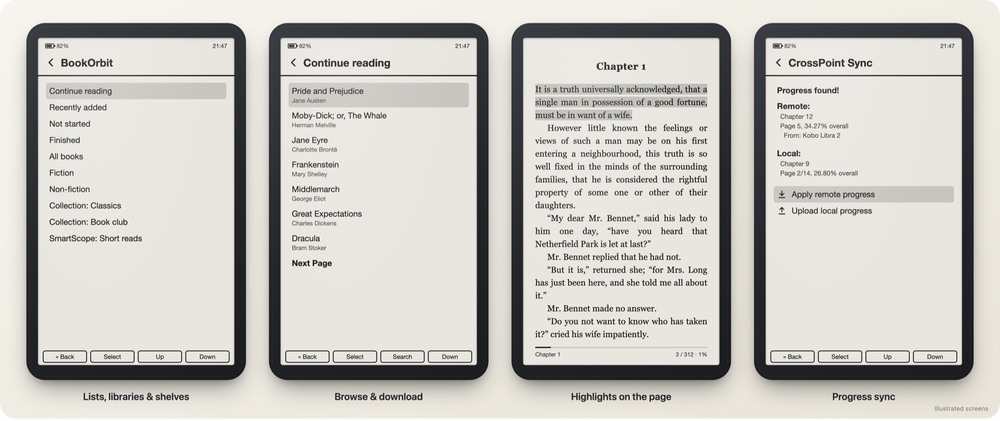
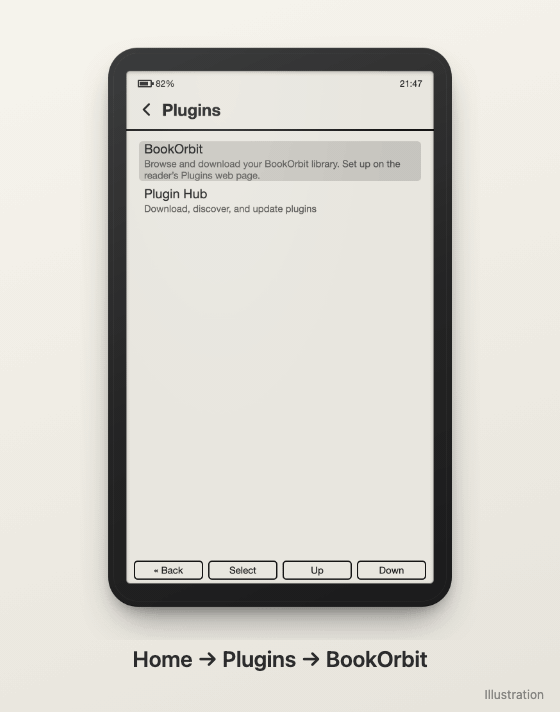
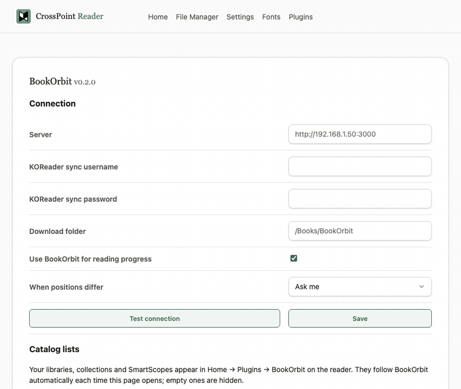
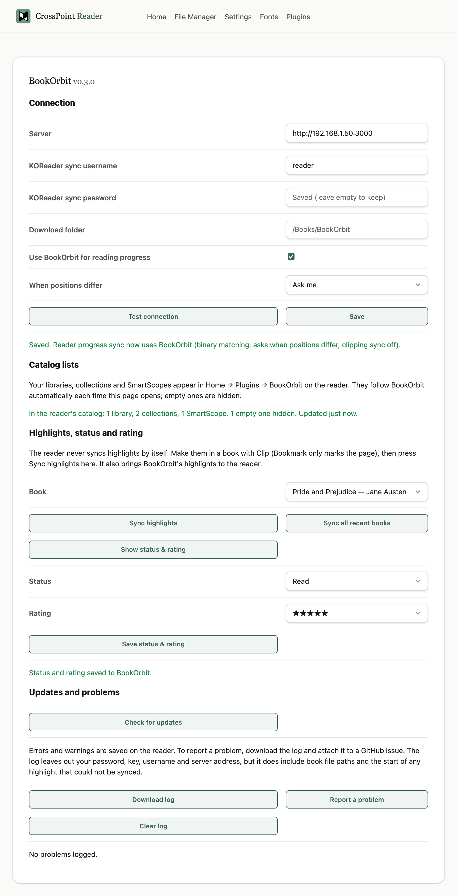

# BookOrbit for CrossPoint

[](https://github.com/ngocmanh1609/bookorbit-sync-crosspoint-plugin/releases/latest)
[](https://github.com/ngocmanh1609/bookorbit-sync-crosspoint-plugin/actions/workflows/tests.yml)
[](LICENSE)

> 💛 Many thanks to [neonsolstice](https://github.com/neonsolstice) for [BookOrbit](https://github.com/bookorbit/bookorbit)
> and its excellent KOReader plugin, whose features this project brings to CrossPoint, and to
> [Styxbleich](https://github.com/Styxbleich) for
> [BookOrbit-Sync-for-Crosspoint](https://github.com/Styxbleich/BookOrbit-Sync-for-Crosspoint), the plugin that
> showed it could be done on CrossPoint and inspired this one.

Your self-hosted [BookOrbit](https://github.com/bookorbit/bookorbit) library on a
[CrossPoint](https://github.com/crosspoint-reader/crosspoint-reader) e-reader. The plugin browses and downloads books,
syncs reading progress and reading sessions, and syncs highlights, read status and ratings. These are the features of
BookOrbit's [KOReader plugin](https://bookorbit.app/koreader-plugin), rebuilt as a CrossPoint SD-card plugin
(`cp-orbit`).

> [!IMPORTANT]
> **Verified on the BOOX Picco only**, running CrossPoint 2.0.0. Other CrossPoint readers (Xteink X3, X4, X4 Pro, …)
> may work but are untested. Reading sessions need a reader with a clock chip. Reports from other devices are welcome.

<p align="center">
  
  <br><sub>Illustrated screens of the on-reader flow. Their layout and wording follow CrossPoint 2.0, but they are not device captures.</sub>
</p>

## Features

<table>
<tr>
<td width="50%" valign="top">

**On the reader**

- **Catalog:** Home → Plugins → BookOrbit lists Continue reading, Recently added, Not started, Finished, All books,
  then each of your libraries, collections and SmartScopes. They follow your server automatically, and empty ones
  are hidden. Search finds a title or author.
- **Downloads:** pick a book and it is saved to `/Books/BookOrbit` (EPUB only; the reader cannot open PDF or CBZ).
- **Reading sessions and stats:** your reading log, streaks and stats update automatically, when the reader connects
  to Wi-Fi or goes to sleep.
- **Reading progress:** sync your position with BookOrbit, and choose which position wins when they differ.

</td>
<td width="50%" valign="top" align="center">
  
  <br><sub>Illustrated walkthrough</sub>
</td>
</tr>
<tr>
<td width="50%" valign="top">

**On the reader's web page**, from a phone or computer on the same Wi-Fi

- **One-time setup:** enter your login once. The plugin also configures the reader's own progress sync for you.
- **Two-way highlights:** new highlights and deletions go both ways when you press **Sync highlights** (the reader
  never syncs them by itself). Every highlight is placed by its position and checked against the book's text.
- **Read status and star rating** for any book.
- **Update notice and problem log:** a banner when Plugin Hub has a new version, and a log you can attach to a
  GitHub issue.

</td>
<td width="50%" valign="top" align="center">
  
  <br><sub>The real web card, recorded against a demo library</sub>
</td>
</tr>
</table>

## Install

You need CrossPoint 2.0.0 or newer, a BookOrbit server the reader can reach, and a BookOrbit **KOReader sync login**
(BookOrbit web → Settings → KOReader). That login is not your BookOrbit web login.

1. Download `cp-orbit-<version>.zip` from the
   [latest release](https://github.com/ngocmanh1609/bookorbit-sync-crosspoint-plugin/releases/latest) and unzip it.
2. Copy the `cp-orbit` folder to `/plugins/` on the reader's SD card, giving `/plugins/cp-orbit/`. Keep that folder
   name: the reader only sends reading sessions to plugin folders named 23 bytes or less.
3. On the reader, turn on **Settings → Connectivity → Plugins**, then open **Home → Plugins** once. No restart is
   needed; turning the reader off and on also works.

Or skip the copying: on the reader, open **Home → Plugins → Plugin Hub** (choose **Install** the first time), find
**BookOrbit** and install it from there.

<details>
<summary>No card reader? Copy it over Wi-Fi instead</summary>

Open **File Transfer** on the reader and note its address (for example `192.168.1.123`). Then, inside the unzipped
folder:

```bash
curl -X POST -d "name=plugins&path=/" http://<reader-ip>/mkdir
```

```bash
curl -X POST -d "name=cp-orbit&path=/plugins" http://<reader-ip>/mkdir
```

```bash
for f in manifest.json device.json plugin.js README.md config.example.json; do curl -X POST -F "file=@cp-orbit/$f" "http://<reader-ip>/upload?path=/plugins/cp-orbit&overwrite=1"; echo; done
```

You can also do the same by hand in the reader's web page, on the **File Manager** tab.

</details>

> [!WARNING]
> If you also installed the older **BookOrbit Sync** plugin (`bookorbit-sync`), remove it. Otherwise both plugins
> send every reading session and BookOrbit counts your reading time twice.

## Set up

1. On the reader, open **File Transfer**. Then open the address it shows in a browser on the same Wi-Fi.
2. Go to the **Plugins** tab and find the **BookOrbit** card.
3. Enter the server address (for example `http://192.168.1.50:3000`) and your KOReader sync username and password.
   Press **Test connection**, then **Save**.

That's all. **Save** does two things:

- It stores your settings in `/.cp-orbit/config.json` on the SD card. Only the MD5 hash of the password is kept
  there; BookOrbit accepts it as the key.
- It points the reader's own progress sync at BookOrbit: server `<your server>/api/v1/koreader`, matching
  **Binary**, the conflict choice you picked, and CrossPoint's clipping sync **off**. BookOrbit doesn't support that
  clipping sync; highlights go through the card instead. If the reader already syncs with another server, the card
  asks before replacing it.

<p align="center">
  
</p>

## Using it

### Reading progress

CrossPoint syncs progress only when you ask, from inside a book:

- **Reader menu → Sync progress** (tap or swipe up to open the menu).
- Or, if your reader lists it, set **Settings → Controls → Short Power Button Click** to **Sync**, so syncing is one
  press.

When this reader and BookOrbit disagree, the reader shows both positions: chapter, page, percentage, and the device
that saved it. Choose **Apply remote progress** to jump to BookOrbit's place, or **Upload local progress** to keep
this one. If you'd rather not be asked, pick **Use the furthest automatically** on the card.

### Reading sessions

Nothing to do. Sessions are recorded as you read and sent whenever the reader connects to Wi-Fi or goes to sleep.
Sending one twice is harmless, because BookOrbit drops duplicates.

### Highlights

> [!IMPORTANT]
> **The reader never syncs highlights by itself.** A highlight you make on the reader stays only on the reader until
> you press **Sync highlights** on the BookOrbit card. Highlights made in BookOrbit or KOReader reach the reader the
> same way.

To sync your highlights:

1. In a book, select a word or a passage and choose **Clip**. That is the highlight. **Bookmark** only marks the page
   and is not synced, and CrossPoint has no notes.
2. On the reader, open **File Transfer**. Open the address it shows in a browser on a phone or computer, then go to
   the **Plugins** tab.
3. On the BookOrbit card, choose the book and press **Sync highlights**. **Sync all recent books** does every book in
   the reader's recent list.
4. Read the result line. If some highlights could not be synced, **Show which** lists each one and the reason.

What a sync does:

- New highlights on the reader go to BookOrbit, and open at the right spot in BookOrbit's web reader.
- New highlights from BookOrbit are added to the reader. One that can't be placed is listed under **Show which**,
  never placed by guessing.
- Deleting a highlight on either side deletes it on the other at the next sync.
- Notes written in BookOrbit or KOReader stay there. The reader can't show them.

The book must be the same file BookOrbit has; books downloaded through the catalog always are. Before every change,
the reader's highlight file is backed up to `/.cp-orbit/backup/`.

<details>
<summary>Why a highlight can't be synced</summary>

| Reason under **Show which** | What it means |
|---|---|
| it spans two chapters | The reader keeps each highlight inside one chapter. Split it at the chapter break on the other device. |
| its text was not found in the chapter | The book's text at that spot is different, usually because it is another edition of the book. |
| its text appears more than once in the chapter | Its position didn't match, and the text alone (often a single word) fits several places. |
| its position is not in this book | The position points outside this book's chapters, so it belongs to another file. |
| the reader's highlight limit for this book is reached | The Picco keeps up to 1024 highlights per book. |
| the reader does not have it | BookOrbit sent a change for a highlight that was deleted on the reader. |
| not an EPUB position | The highlight was made in a PDF copy of the book. |

</details>

### Catalog lists: libraries, collections and SmartScopes

Each library, collection and SmartScope on your server gets its own entry in Home → Plugins → BookOrbit:

```
Continue reading · Recently added · Not started · Finished · All books
Fiction                      ← a library
Collection · Classics
SmartScope · Short reads
```

The card keeps these entries matched to BookOrbit every time its web page opens, and after **Save**. New ones
appear, deleted ones go, and a collection or SmartScope with no books is hidden. If BookOrbit can't be reached, the
last known lists stay.

> [!NOTE]
> **The entries are flat, not folders.** CrossPoint's firmware gives plugin catalogs a single level of lists:
> choosing an entry opens its books, and choosing a book downloads it. A "Collections" entry that opens a list of
> your collections, each opening its books, can't be built in a plugin today. So each collection and SmartScope is
> listed directly, with a `Collection ·` or `SmartScope ·` prefix.
>
> For folder-style browsing, CrossPoint's built-in **OPDS** browser can show BookOrbit's OPDS feed, which nests
> libraries, collections and SmartScopes. It needs a separate OPDS user, set up in BookOrbit.

### Status and rating

**Show status & rating** looks the book up and shows its current values. Change them, then press **Save status &
rating**.

<details>
<summary>Every control on the card</summary>

| Control | What it does |
|---|---|
| Server | Your BookOrbit address. `http://` is added if you leave it out. |
| KOReader sync username / password | Your BookOrbit KOReader sync login. After saving, leave the password empty to keep it. |
| Download folder | Where catalog downloads go. Default `/Books/BookOrbit`. |
| Use BookOrbit for reading progress | When ticked, **Save** also sets up the reader's progress sync. |
| When positions differ | **Ask me**, or **Use the furthest automatically**. |
| **Test connection** | Checks the address and login. Saves nothing. |
| **Save** | Checks the login, saves the settings and, if ticked, sets up progress sync. Nothing is saved if the login fails. |
| Catalog lists | No button: opening the page (or **Save**) updates the reader's library, collection and SmartScope entries. |
| Book | The book the buttons below work on: a recent book, or **Another book** to type a path. |
| **Sync highlights** | Two-way highlight sync for that book. |
| **Sync all recent books** | Sync highlights for every recent book, with a result line for each. |
| Show which | Appears after a sync when some highlights couldn't be synced, and lists each one with the reason. |
| **Show status & rating** | Shows the book's current status and rating. Changes nothing. |
| **Save status & rating** | Sends the status and rating shown to BookOrbit. |
| **Check for updates** | Asks Plugin Hub for a newer cp-orbit right away. The card also checks by itself once a day. |
| **Download log** | Saves the problem log, with a summary of the reader's setup, as a text file. |
| **Report a problem** | Opens a new GitHub issue with your versions filled in. Attach the downloaded log to it. |
| **Clear log** | Empties the problem log. |

</details>

## Updating

**On the reader (recommended):** open **Home → Plugins → Plugin Hub → BookOrbit** and choose **Update**. If Plugin
Hub isn't there yet, choose **Home → Plugins → Plugin Hub → Install** first. The card on the web page shows a banner
when an update is out. The banner waits until Plugin Hub can install the update, because the Hub refreshes its list a
few times a day.

**By hand:** use **Sync progress** (or connect the reader to Wi-Fi) so queued reading sessions go out first. Then copy
the new `cp-orbit` folder over the old one ("Replace" is fine). A "Replace" deletes sessions that haven't been sent
yet; Plugin Hub keeps them.

Either way, **no restart is needed** on CrossPoint 2.0.0, because the reader reads the new files the next time it uses
them. If you copied the files over Wi-Fi, just leave File Transfer. Reload the web page if it was open.

Your settings, sync state and problem log live in `/.cp-orbit/`, outside the plugin folder, so you never re-enter
them. Until you next open the card, the catalog shows your libraries but not your collections or SmartScopes. Opening
the card puts them back. Deleting `/.cp-orbit/` resets the plugin.

## Reporting a problem

The card saves its errors and warnings to `/.cp-orbit/logs/cp-orbit.log` on the reader. To report a problem:

1. On the card, under **Updates and problems**, press **Download log**. The browser saves `cp-orbit-log-<date>.txt`.
2. Press **Report a problem**. A new GitHub issue opens with your versions filled in.
3. Describe what happened, and drag the log file into the issue.

The log leaves out your password, key, username, server address and device ID. It does include book file paths and
the start of any highlight that couldn't be synced, so read it before posting. Problems on the reader itself
(catalog, downloads, progress sync) only reach the reader's serial port, not this log, so describe those in the issue.

## Troubleshooting

| Problem | Fix |
|---|---|
| **My highlight isn't in BookOrbit** | The reader never sends highlights by itself. Make it with **Clip** (not Bookmark), then press **Sync highlights** on the card. See [Highlights](#highlights). |
| **"… from BookOrbit could not be placed in this book"** | Press **Show which** under the result to see each highlight and why. Most often it spans two chapters, or the book is a different file from BookOrbit's. |
| **"Sync failed. Could not sync clippings"** | The reader's clipping sync is on, and BookOrbit doesn't support it. Untick **Settings → Connectivity → CrossPoint Sync → Sync Clippings**, or press **Save** on the card again. |
| The Picco isn't in BookOrbit's **Devices** list | That list only shows devices that have uploaded a position. Use **Sync progress** and choose **Upload local progress**. The reader appears as **"CrossPoint"**, a name fixed in the firmware. |
| The catalog shows an error | Set up the card first, and check that the reader can reach the server address. |
| A collection or SmartScope is missing, or all of them after an update | Open the card's web page once; it updates the lists. Empty ones (no books) are hidden. |
| No reading sessions in BookOrbit | The folder must be `/plugins/cp-orbit`. After installing, open **Home → Plugins** once (or restart the reader), and make sure the reader shows the correct time. |
| A downloaded book won't open | That book's first file in BookOrbit isn't an EPUB (see [known issues](KNOWN_ISSUES.md)). |
| Anything else | [Report a problem](#reporting-a-problem) with the log attached. |

## What CrossPoint can't do

CrossPoint plugins can't draw their own screens or run code on the reader, and their catalogs have one level of
lists, so collections and SmartScopes can't be folders (see [Catalog lists](#catalog-lists-libraries-collections-and-smartscopes)).
The KOReader plugin's dashboard, widgets, covers, bulk download and bookmark sync therefore have no equivalent.
Progress and highlights never sync on their own: you start progress with Sync progress, and highlights from the card.
A plugin also can't restart the reader, and an update doesn't need a restart. All limits are listed in
[KNOWN_ISSUES.md](KNOWN_ISSUES.md).

## Security

- The SD card holds the MD5 hash of your KOReader sync password, which BookOrbit accepts as the key. Use a dedicated
  sync login, and `https` or a trusted network.
- The plain password is only handed to the reader's own (obfuscated) credential store. The plugin never writes it
  anywhere.

## Development

```bash
npm ci
npm test
```

```bash
sh scripts/package.sh
```

- `npm test` runs 49 tests against a mock BookOrbit and the firmware's rules. They cover the highlight-file format,
  position mapping, the two-way exchange, `device.json` templates, the problem log and its redaction, the update
  notice, the Plugin Hub rules and the release zip.
- `sh scripts/package.sh` builds `dist/cp-orbit-<version>.zip`.
- To release, push a tag `v<version>` that matches `manifest.json`. GitHub Actions then tests the code, builds the
  zip and publishes the release.

This plugin was written from the CrossPoint firmware and BookOrbit server sources. It is not affiliated with either
project. MIT licensed.
