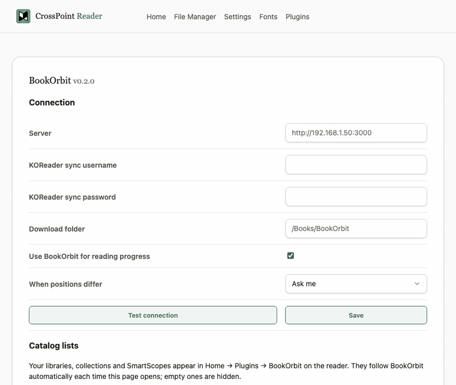

First release of **cp-orbit**, BookOrbit for CrossPoint.

> **Verified on the BOOX Picco (CrossPoint 2.0.0) only.** Other CrossPoint readers may work but are untested.

## What's in it

- **On-device catalog:** Continue reading, Recently added, Not started, Finished, All books, your libraries, and
  Search. Download any EPUB to `/Books/BookOrbit`.
- **Reading sessions and stats** go to BookOrbit automatically, when the reader goes online or to sleep.
- **Reading progress:** the web card sets the reader's own KOReader sync to BookOrbit: binary matching, a conflict
  prompt, clipping sync off.
- **Two-way highlights** from the web card: new highlights and deletions go both ways, and every change is checked
  against the book's text.
- **Read status and star rating** from the web card.
- **Collections and SmartScopes** can be added to the on-device catalog.
- **Settings survive updates:** they live in `/.cp-orbit/` on the SD card.

## Install

1. Download `cp-orbit-0.1.0.zip` below and unzip it.
2. Copy the `cp-orbit` folder to `/plugins/` on the reader's SD card, giving `/plugins/cp-orbit/`.
3. On the reader: **Settings → Connectivity → Plugins** → on, then restart.
4. Open the reader's web page (File Transfer) → **Plugins** → **BookOrbit**. Enter your server and KOReader sync
   login, then press **Save**.

## Update from an earlier version

Use **Sync progress** on the reader, copy the new `cp-orbit` folder over the old one, then restart.

See [KNOWN_ISSUES.md](https://github.com/ngocmanh1609/bookorbit-sync-crosspoint-plugin/blob/main/KNOWN_ISSUES.md) for
limitations.
